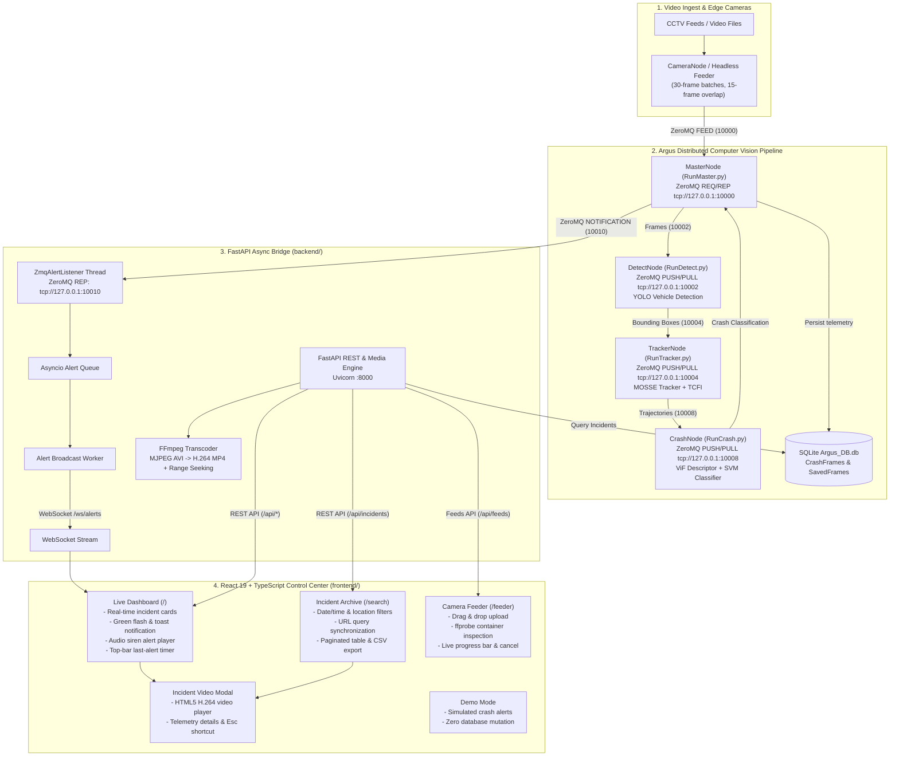

<!-- PROJECT LOGO -->
<br />

  <h1 align="center">ARGUS</h1>
<p align="center">
  
</p>

  <p align="center">
An autonomous system based on computer vision techniques that detects road accidents and reports them in real-time as well as allowing the monitoring of accidents using a client server architecture and an interactive GUI.    <br />
    <a href="https://github.com/khaledsabry97/Argus/blob/master/Documents/GP_document.pdf"><strong>Explore Full Documentation »</strong></a>
    <br />
    <br />
    <a href="#IEEE-Research">IEEE Research Paper</a>
    .
    <a href="#ieee-conference-presentation-video">IEEE Presentation</a>
    ·
    <a href="#Demo">View Demo</a>
    ·
    <a href="#System-Architecture">System Architecture</a>
    ·
    <a href="https://github.com/khaledsabry97/Argus/issues">Request Feature</a>
  </p>

<p align="center">
 


 </p>

  <h2 id="IEEE-Research">
IEEE Research Paper</h2>


  <p> 
    This paper proposes a framework to detect road accidents in real-time using generic CCTV cameras installed on roads. The framework focuses on how to achieve high performance on congested roads by introducing a new technique called track-compensated frame interpolation (TCFI) for tracking the vehicles, focuses on achieving higher accuracy by introducing a new approach for crash detection called crash estimation algorithm and focuses on how the system will deal with the massive number of CCTV cameras by dropping footages that are highly unlikely to contain an accident at an early stage and implemented the modules based on the pipelining technique. The framework is formed up of four stages; first, vehicles are detected using YOLO neural network, then tracked for several frames using MOSSE tracker, followed by a filtration process based on a new approach of crash estimation; finally, for every vehicle, we process its tracked footage through ViF descriptor then use the output as a feature vector for an SVM model that classifies accidents. The system achieves 93% accuracy with processing time beats all previous systems.
  </p>
  <h4><a href="https://ieeexplore.ieee.org/document/9698968/">
Research Paper On IEEE </h4>
<h5 id="IEEE-Cite">
Citation</h5>

```
K. Sabry and M. Emad, "Road Traffic Accidents Detection Based On Crash Estimation," 2021 17th International Computer Engineering Conference (ICENCO), 2021, pp. 63-68, doi: 10.1109/ICENCO49852.2021.9698968.
  
```

## Architecture & System Topology

The system integrates a distributed computer vision pipeline with an asynchronous FastAPI bridge and a modern React 19 control-room web application:



---

## Limitations & Decision Support Disclaimer

> [!WARNING]
> ### Critical Operational Notice & Limitations
> 1. **Detection Accuracy Scope**: The 93% accuracy figure reported in the original research paper (*"Road Traffic Accidents Detection Based On Crash Estimation", IEEE ICENCO 2021*) was obtained by the authors on their specific recorded dataset. **This detection accuracy has not been independently verified on external traffic camera networks or varied public benchmarks.** Environmental factors such as severe weather, night glare, lens distortion, heavy congestion, or vehicle occlusion can significantly affect detection outcomes.
> 2. **Decision Support Tool Only**: Argus is engineered strictly as an **assisted decision support platform** for human traffic operators and first-response monitoring centers. It does **not** make autonomous legal accident determinations or automated emergency response decisions.
> 3. **Mandatory Human Verification**: **A qualified human operator must review and confirm every alert and associated video footage before initiating emergency dispatch, dispatching roadside assistance, or issuing traffic management actions.** The software must never operate unattended without human-in-the-loop oversight.

---

## Python & System Environment Requirements

> [!IMPORTANT]
> **Argus requires Python 3.11.**
> Python 3.14 removed the deprecated standard library module `imghdr`, which causes legacy computer vision modules to fail on import. Python 3.11 is fully supported and verified across all tests.

### Virtual Environment Setup
```bash
# 1. Install Python 3.11 and ffmpeg
brew install python@3.11 ffmpeg          # macOS
# or sudo apt install python3.11 python3.11-venv ffmpeg  # Ubuntu/Debian

# 2. Create and activate virtual environment
python3.11 -m venv .venv
source .venv/bin/activate

# 3. Install dependencies
pip install -r requirements.txt
pip install -r backend/requirements.txt

# 4. Install frontend dependencies
cd frontend && npm install --legacy-peer-deps && cd ..
```

---

## Quickstart: Running the Stack

### Option A: Unified Orchestration (Recommended)
You can run the entire system (all 4 computer vision nodes + FastAPI bridge + React frontend) with a single command:

```bash
# 1. Verify environment prerequisites and network ports
make check

# 2. Launch all 6 services with automated port readiness checks & colored log prefixes
make dev

# 3. Stop all background services cleanly
make stop
```

Once started:
* **React Web Frontend**: [http://localhost:5173](http://localhost:5173)
* **FastAPI Bridge Swagger Docs**: [http://127.0.0.1:8000/docs](http://127.0.0.1:8000/docs)
* **WebSocket Alerts Stream**: `ws://127.0.0.1:8000/ws/alerts`

### Option B: Running the Web Stack with Standalone Simulator
If you want to run the React frontend and FastAPI bridge without launching the heavy legacy Argus computer vision nodes:

```bash
# Terminal 1: Start FastAPI Bridge
.venv/bin/uvicorn backend.app.main:app --host 127.0.0.1 --port 8000 --reload

# Terminal 2: Start React Frontend
cd frontend && npm run dev

# Terminal 3: Fire a simulated ZeroMQ crash alert to port 10010
.venv/bin/python scripts/fake_alert_publisher.py --camera-id 8820 --city "Cairo" --district "District 7"
```

### Option C: Client-Side Demo Mode
Open the React app at [http://localhost:5173](http://localhost:5173) and click the **DEMO MODE** badge in the navigation bar. Demo Mode replays simulated alerts at regular intervals with visual and siren audio indicators, clearly tagged with `DEMO` badges, without modifying the underlying database.

---

## React Control Center Features (`frontend/`)

1. **Live Dashboard (`/`)**:
   - Real-time accident cards (newest first) displaying camera ID, timestamp, and location.
   - Live WebSocket alert banners that flash green and emit audio alarms.
   - Interactive siren audio player (`UI/siren.mp3`) with browser unlock button and volume slider.
   - Top-bar relative timer showing time elapsed since the last alert.
   - Video modal with HTML5 H.264 playback, HTTP range seeking, telemetry metadata, and `Esc` key handling.

2. **Incident Search & Archive (`/search`)**:
   - Temporal filters (date range, time range) and geographic filters (city, district).
   - Form validation via `react-hook-form` + `zod` schema validation.
   - Search parameters synchronized with URL query parameters for shareable links.
   - Sortable columns, thumbnail previews, pagination, and one-click video player.
   - **CSV Export**: Direct one-click download via `GET /api/incidents/export`.

3. **Camera Feeder / Ingest Simulation (`/feeder`)**:
   - Web replacement for `RunCamera.py`.
   - Drag-and-drop video upload (MP4, AVI, MKV, MOV up to 200MB) with `ffprobe` format inspection.
   - First-frame thumbnail preview with play-button overlay.
   - Launches headless `CameraNode` subprocess streaming 30-frame batches with 15-frame overlap to Master node.
   - Live progress bar polling `GET /api/feeds/{id}`, percentage display, and cancel action.
   - Enforces single active feed concurrency (`409 Conflict` if busy).

4. **Accessibility & Design Polish**:
   - Dark control-room aesthetic with cyan and emerald accents.
   - Keyboard accessible focus rings (`focus-visible`).
   - `prefers-reduced-motion` support honoring operating system preferences.
   - Custom Argus SVG emblem and favicon.

---

## Testing & Quality Assurance

```bash
# 1. Run all backend tests (21 pytest tests for ZeroMQ bridge, database, video streaming, and feeds)
cd backend && PYTHONPATH=. ../.venv/bin/pytest -v

# 2. Run frontend unit tests (Vitest tests for alert socket hook and search validation)
cd frontend && npm run test:unit

# 3. Run frontend linter and TypeScript type-check
cd frontend && npm run lint && npm run build

# 4. Run end-to-end Playwright smoke test (spins stack, dispatches fake alert, asserts card & video player)
cd frontend && npx playwright test
```

---

## Continuous Integration (GitHub Actions)

A GitHub Actions workflow is configured in `.github/workflows/ci.yml` that automatically validates every push and pull request:
- **Backend Job**: Sets up Python 3.11 and ffmpeg, installs dependencies from `backend/requirements.txt`, and executes the 21 pytest tests.
- **Frontend Job**: Sets up Node.js 20, runs Oxlint, executes TypeScript type-checking (`tsc -b`), builds the production bundle with Vite, and runs Vitest unit tests.
- *Note*: CI skips running the heavy legacy Argus CV nodes to ensure rapid, deterministic build times.

---

## How to Configure used modules in Project

As the project has different settings there are hyper-parameter you need to configure to use the module you actually want. Go to file called "Constants.py" in "Argus/System/Data/Constants.py"

 <details>
  <summary><b>In Detection Module</b></summary>
   <ul>
    <li> Work_Detect_Files : True if you want to use already saved vehicles detected in the videos provided in project instead of using YOLO architecture</li>
     </ul>
         </details>
         
 <details>
  <summary><b>In Tracking Module</b></summary>
  <ul>
    <li> Work_Tracker_Type_Mosse : True if you want to use Mosse Tracker instead of Dlib Tracker </li>
    <li> Work_Tracker_Interpolation : True if you want to use track-compensated frame interpolation (TCFI) instead of normal tracking algorithm
 </li>
    </ul>
         </details>
         
         
 <details>
  <summary><b>In Crash Module</b></summary>
   <ul>
    <li> Work_Crash_Estimation_Only : True if you want to use Crash Estimation Module Only, instead of following the Crash Estimation Module with ViF Descripton</li>
     </ul>
         </details>


## IEEE Conference Presentation Video
<p align="center" id="IEEE-Presentation">
   <a href="https://www.youtube.com/watch?v=rm5pcUggZzs">

      </a>
  </p>

## Trailers
#### Trailer 1
The trailer gives a light on the problem so the audience can start thinking about it.
The trailer captures the audience's mind and the audience will ask themselves....
What is ARGUS?
How will it help to save people's lives?
<p align="center">
   <a href="https://www.youtube.com/watch?v=8GmcOIeVAp4">

      </a>
  </p>
  

#### Trailer 2 (Main Trailer)
The trailer discusses the problem of road crashes and how argus will help to solve this problem
<p align="center">
  
   <a href="https://www.youtube.com/watch?v=nHsk8bgKjX0">

      </a>
  </p>


  <h2 id="Demo">
Demo
</h2>

#### Explaination
Explaining in Arabic how to test a video in Argus
<p align="center">
   <a href="https://www.youtube.com/watch?v=92DqypG8TKY">

      </a>
  </p>
  
#### Output
The video shows a compilation of road crashes which is the output of the system

<p align="center">
   <a href="https://www.youtube.com/watch?v=R74K5aWLSLk">

      </a>
  </p>


  
